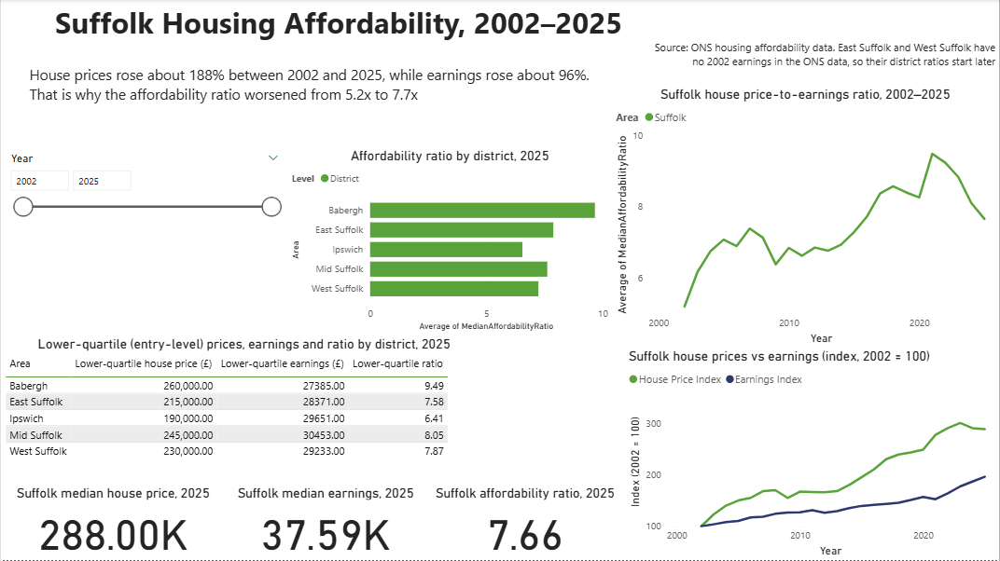

# Suffolk Housing Affordability (Power BI)

Power BI dashboard analysing house price affordability in Suffolk and its five districts, 2002–2025, using ONS data.

**How to view:** Open Suffolk_Housing_Affordability.pbix in Power BI Desktop (free), or see dashboard.png for a preview.

## Summary of findings
- Median house prices rose about 188% between 2002 and 2025; median earnings rose about 96%
- The price-to-earnings ratio rose from 5.2x (2002) to a peak of 9.5x (2021), then eased to 7.7x (2025). The 5-year average is 8.7x
- Babergh is the least affordable district (9.7x in 2025) and Ipswich the most affordable (6.6x)
- Entry-level (lower-quartile) affordability is worse than the median: Babergh 9.49 in 2025
- For context in 2025: Norfolk 7.5x, Cambridgeshire 8.4x, Essex 8.9x

## Data notes and limitations
- 2025 earnings are provisional and may be revised
- East Suffolk and West Suffolk have no 2002 earnings, so their ratios start later
- Some areas use annualised weekly earnings, which ONS says are not directly comparable
- Ratios use residence-based, full-time earnings

## My interpretation (not an official recommendation)
- The gap between price growth and earnings growth explains most of the change in the ratio
- Entry-level affordability in the most stretched districts (such as Babergh) deserves the closest attention
- Tracking the lower-quartile ratio alongside the median would give a fuller picture

## How it was built
- Power BI Desktop with DAX measures (House Price Index and Earnings Index, 2002 = 100)
- Year slicer, district comparison, trend and table views

## Source
Office for National Statistics: House price (existing dwellings) to residence-based earnings ratio
https://www.ons.gov.uk/peoplepopulationandcommunity/housing/datasets/housepriceexistingdwellingstoresidencebasedearningsratio
